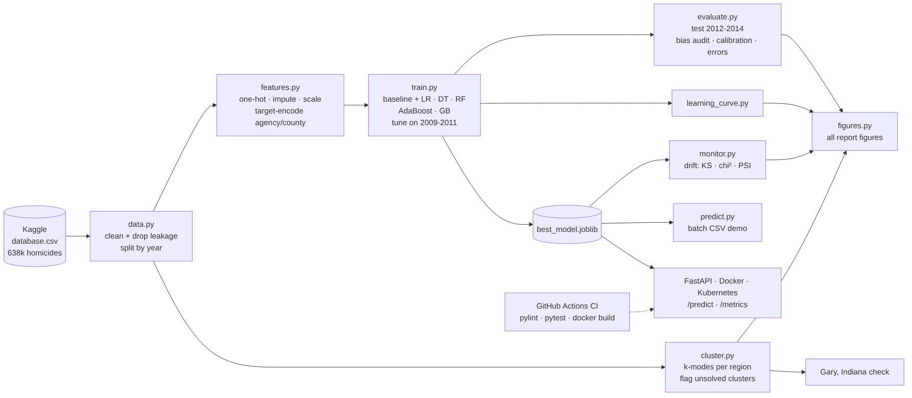

# Predicting Unsolved Homicides and Detecting Serial-Offender Patterns

61.501 Production Ready Machine Learning (SUTD, 2026) - group project, theme *AI for Social Good*.

Rick van Kammen (1012178) · Gosse Zandstra (1012168) · Tim Krol (1012167) ·
Nishant Maheshwari (1012067) · Logan Fan Stephens (1012114)

About 3 in 10 US homicides are never solved. This project builds two classical
(non-deep-learning) tools that could help police spend their attention better:

1. **Solvability classifier** - predicts, from information known when a case is opened,
   the probability that a homicide will *not* be solved, and flags cases that are likely
   to go cold.
2. **Cluster detector** - groups all homicides in a region with similar victims, places
   and weapons (k-modes) and flags groups with a significantly high share of unsolved
   cases as possible serial-offender patterns. We validate it on the Gary, Indiana case.



## Results

Test years 2012-2014 (43,809 cases, 30% unsolved). The model was selected on the
validation years 2009-2011 and evaluated once on test. Positive class = *unsolved*.

| Model | Average precision | ROC AUC | F1 (unsolved) | Recall | Precision |
|---|---|---|---|---|---|
| Majority baseline | 0.302 | 0.500 | 0.000 | 0.000 | 0.000 |
| Logistic regression | 0.484 | 0.719 | 0.549 | 0.740 | 0.437 |
| Decision tree | 0.536 | 0.723 | 0.549 | 0.693 | 0.455 |
| AdaBoost | 0.526 | 0.745 | 0.566 | 0.702 | 0.475 |
| Gradient boosting | 0.572 | 0.759 | 0.575 | 0.688 | 0.494 |
| **Random forest (selected)** | **0.569** | **0.753** | **0.569** | **0.661** | **0.500** |

* The random forest finds two thirds of the cases that stay unsolved; half of the cases it
  flags really do go cold, against 30% by chance. Gradient boosting is about equally good
  on test (difference 0.003, paired bootstrap 95% interval -0.000 to +0.007,
  `bootstrap_ci.csv`); the random forest was chosen because it was best on validation.
* Most important inputs: the investigating agency, the weapon and the county.
* Bias audit: cases with Black victims are flagged more often (52% vs 27% for White
  victims). This mirrors real differences in clearance rates (39.5% vs 20.7% unsolved),
  but the false-positive rate is also higher (0.39 vs 0.20). Per-group thresholds chosen
  on validation bring both false-positive rates to about 0.28 at a cost of 0.02 F1
  (`fairness_thresholds.csv`). The model should support, not replace, a human decision.
* Calibration: Brier score 0.175 against 0.211 for always predicting the base rate
  (`calibration_summary.json`, figure 12).
* Leakage check: whether `Perpetrator Sex` is "Unknown" matches whether the case is
  unsolved in 99.97% of all cases, so this column alone would "predict" the label; all
  perpetrator columns are therefore dropped (`leakage_check.csv`).
* Drift: the agency (PSI 0.19), `State` and `Weapon` (0.17) and the county (0.13) shift
  moderately between training and test years; the predictions themselves are stable
  (PSI 0.004) and performance per test year is stable (average precision 0.578, 0.564,
  0.565).

**Cluster detector (Indiana, k = 40):** 5 of 40 clusters are flagged (3 after Bonferroni
correction), all in Lake County. 12 of the 16 unsolved strangulations/suffocations of women
in Lake County land in a flagged cluster, but that cluster is broader (female victims in
Lake County) and is not significant after Bonferroni correction, and the result depends
on k (0-13 of 16). The other flagged clusters are young male handgun victims in Lake
County: the detector also picks up areas where clearance is low in general, not only
possible serial offenders. See `reports/metrics/gary_check.json` and figure 9.

## How the project uses the course

| Lecture | Where in this project |
|---|---|
| L2-L4 Linear classification, logistic regression | `train.py`: logistic regression with tuned regularisation `C` |
| L6b Feature engineering & imputation | `features.py`: median imputation + missing-value indicator, one-hot encoding, scaling, target encoding of agency/city |
| L7 Clustering (k-means, k-medoids, elbow) | `cluster.py`: k-modes (k-means for categorical data), elbow method + silhouette score |
| L9 Decision trees & ensembles | `train.py`: decision tree (gini vs entropy), random forest (bagging), AdaBoost (boosting), gradient boosting |
| L13 Containerization | `Dockerfile` |
| L14 REST API | `app/main.py` (FastAPI: `/predict`, `/health`, `/metrics`) |
| L15 Kubernetes | `k8s/deployment.yaml`, `k8s/service.yaml` |
| L17 Monitoring & dashboarding | `monitor.py`: data drift (Kolmogorov-Smirnov, chi-square, PSI), prediction drift, performance per year; `/metrics`: the four golden signals |
| L18 CI/CD | `.github/workflows/ci.yml`: pylint, pytest, Docker build on every push |

## Repository layout

```
config.yaml              every setting: paths, split years, feature lists, grids, seed
src/homicide/
  data.py                load, clean (drop leakage columns), split by year
  features.py            preprocessing: one-hot, imputation, scaling, target encoding
  train.py               baseline + 5 models, tuning on validation, model selection
  evaluate.py            test metrics, bias audit, fairer thresholds, calibration,
                         feature importance, error examples
  learning_curve.py      validation score against training-set size
  monitor.py             drift monitoring (KS, chi-square, PSI) and performance per year
  cluster.py             k-modes cluster detector + Gary, Indiana check
  figures.py             recreates every figure in reports/figures
  predict.py             batch demo: CSV in, predictions out
app/main.py              FastAPI service (/health, /predict, /metrics)
notebooks/               walkthrough notebook that calls the modules above
tests/                   unit tests (synthetic data, no download needed)
reports/figures          all figures used in the report
reports/metrics          all numbers used in the report (CSV/JSON)
docs/pipeline.png        pipeline diagram (source: docs/pipeline.mmd)
docs/references.md       all references (APA 7)
pyproject.toml           package definition (`pip install -e .`)
Dockerfile               container for the API
k8s/                     Kubernetes deployment and service
.github/workflows/ci.yml CI pipeline: lint, test, build
```

## Installation

Python 3.12 or newer (tested with Python 3.13 on Linux, 2 CPU cores, 8 GB RAM).

```bash
git clone https://github.com/gossezandstra-star/homicide-solvability.git
cd homicide-solvability
python -m venv .venv && source .venv/bin/activate   # Windows: .venv\Scripts\activate
pip install -r requirements.txt
pip install -e .                                    # makes `import homicide` work everywhere
```

Download the dataset as described in [`data/README.md`](data/README.md) (Kaggle, or the
copy in our [Google Drive folder](https://drive.google.com/drive/folders/1tQ5p2fzfX3OZpEVNDJIBHh9-n-fuUDcx?usp=sharing))
and put it at `data/raw/database.csv`.

## Reproduce everything

All randomness is fixed with `seed: 42` in `config.yaml`. Run from the project root:

```bash
make all          # = the seven commands below
```

or step by step (if you skipped `pip install -e .`, first run `export PYTHONPATH=src`,
or `$env:PYTHONPATH="src"` in Windows PowerShell):

| Step | Command | Output | Time* |
|---|---|---|---|
| 1. Clean + split | `python -m homicide.data` | `data/processed/{train,val,test}.parquet` | ~10 s |
| 2. Train + tune | `python -m homicide.train` | `models/*.joblib`, `reports/metrics/tuning_results.csv`, `validation_summary.json` | ~20 min |
| 3. Test evaluation | `python -m homicide.evaluate` | `test_results.csv`, `bootstrap_ci.csv`, `bias_audit.csv`, `fairness_thresholds.csv`, `calibration.csv`, `feature_importance.csv`, `error_examples.csv` | ~4 min |
| 4. Learning curve | `python -m homicide.learning_curve` | `learning_curve.csv` | ~10 min |
| 5. Drift monitoring | `python -m homicide.monitor` | `drift_report.csv`, `performance_by_year.csv` | ~30 s |
| 6. Cluster detector | `python -m homicide.cluster` | `elbow.csv`, `clusters.csv`, `gary_check.json` | ~10 min |
| 7. Figures | `python -m homicide.figures` | `reports/figures/fig01...fig13` | ~15 s |

\*on 2 CPU cores. Every figure is produced by step 7 from the files of steps 1-6; the
table in `src/homicide/figures.py` lists which file each figure comes from, and the
appendix of the report maps every report figure to its file.

The trained models are not stored in git (too large). Re-run step 2, or download them
from [Google Drive](https://drive.google.com/drive/folders/1tQ5p2fzfX3OZpEVNDJIBHh9-n-fuUDcx?usp=sharing) and put `best_model.joblib` in `models/`.

The final report is in [`reports/report.pdf`](reports/report.pdf).

## Demo

**Batch (CSV in, CSV out):**

```bash
python -m homicide.predict examples/sample_input.csv predictions.csv
```

**REST API:**

```bash
export API_KEY=change-me                  # optional; without it no key is needed (local demo)
uvicorn app.main:app --port 8000          # then open http://localhost:8000/docs
```

```bash
curl -X POST http://localhost:8000/predict -H "Content-Type: application/json" \
  -H "X-API-Key: change-me" \
  -d '[{"Year": 2014, "State": "Indiana", "City": "Lake", "Victim Sex": "Female",
        "Victim Age": 31, "Victim Race": "Black", "Weapon": "Strangulation"}]'
```

**Docker** (after step 2, because the image contains `models/best_model.joblib`):

```bash
docker build -t homicide-solvability:1.0 .
docker run --rm -p 8000:8000 -e API_KEY=change-me homicide-solvability:1.0
```

Security: `/predict` and `/metrics` need the `X-API-Key` header when `API_KEY` is set
(`/health` stays open for the probes); one request may hold at most `MAX_CASES` cases
(default 1000) and inputs are range-checked; the service writes no case data to disk;
the container runs as a non-root user.

**Kubernetes** (after building the image):

```bash
kubectl apply -f k8s/
kubectl port-forward service/homicide-solvability 8000:80
```

## Monitoring

* `GET /metrics` reports the four golden signals of the running service - latency
  (p50/p95/max), traffic, errors and saturation (memory, CPU) - plus the mean predicted
  P(unsolved) and the flag rate.
* `python -m homicide.monitor` checks data drift per feature (Kolmogorov-Smirnov for
  numeric, chi-square for categorical, Population Stability Index for all) and prediction
  drift, using the test years as a stand-in for production data.
* Whether a case is solved is only known months or years later (feedback delay), so
  drift on the inputs and on the predictions is the early warning; performance per year
  is checked once labels arrive. Plan: retrain once a year when new SHR data is released.

## Tests and CI

```bash
pytest -q                  # unit tests on synthetic data
pylint src app             # code quality (config in .pylintrc)
```

GitHub Actions (`.github/workflows/ci.yml`) runs pylint, pytest and a Docker build on
every push.

## References

See [`docs/references.md`](docs/references.md) (APA 7).

## Data and licence

Murder Accountability Project, *Homicide Reports, 1980-2014*, Kaggle, CC BY-SA 4.0.
